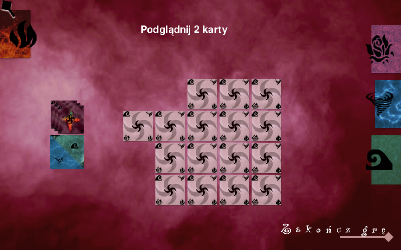
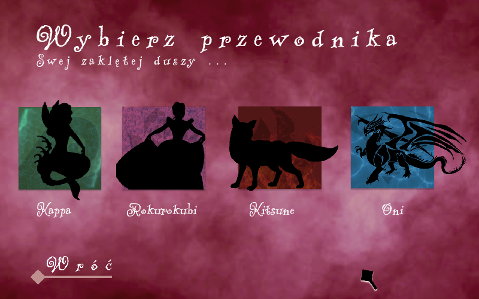
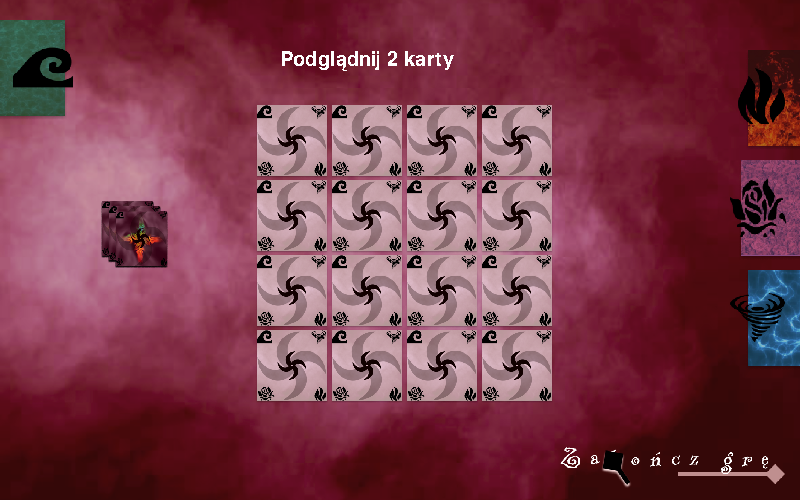
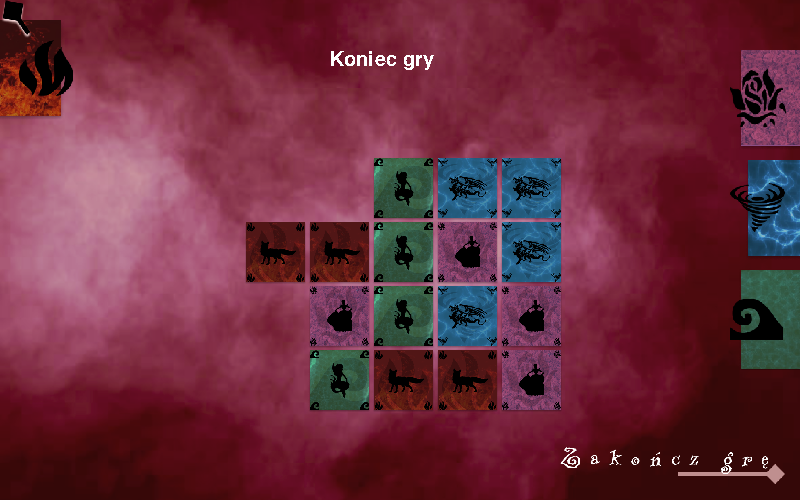
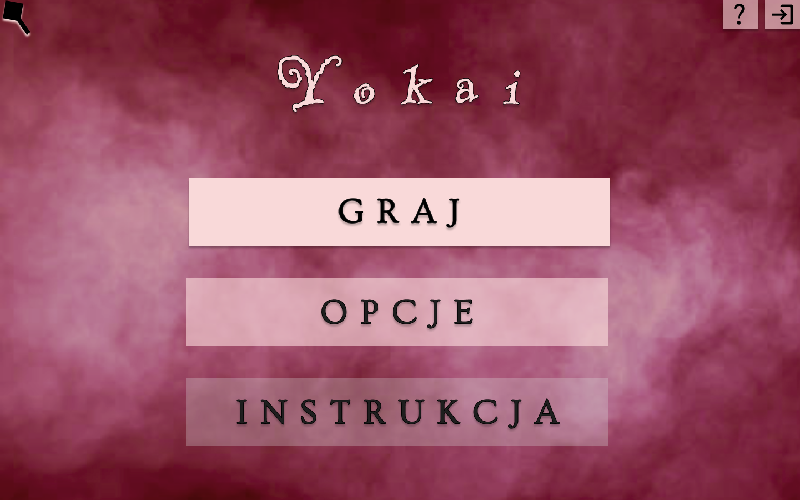
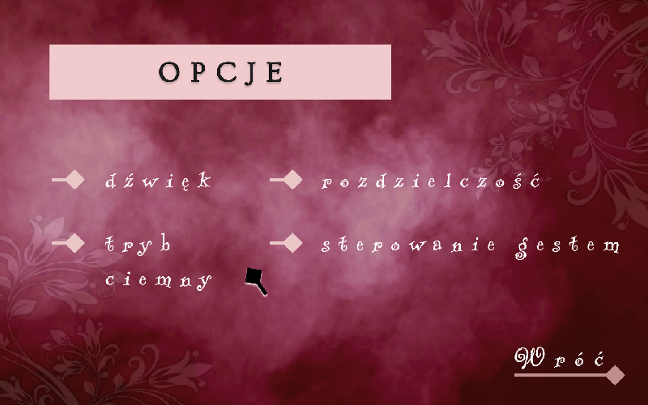
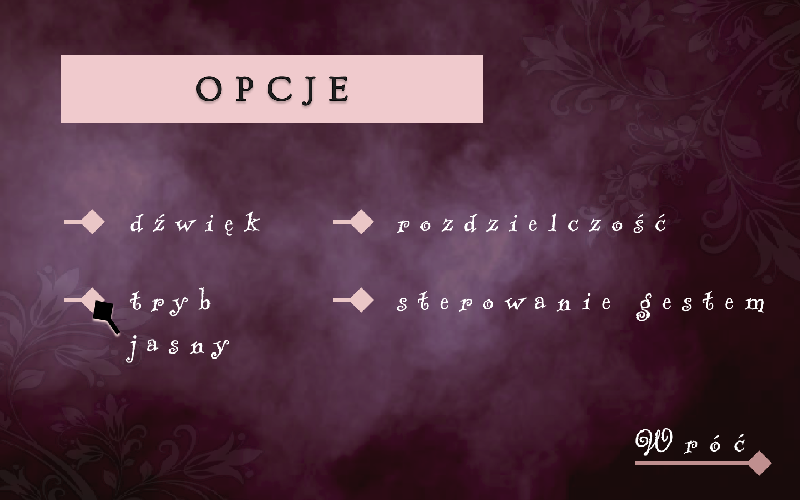

<div align="center">

# YoukaiGame · Yokai

**Discover the spirits. Remember their positions. Bring the families together.**

A Python card game based on the physical **Yōkai** cooperative card game, with illustrated cards, light and dark themes, and experimental hand gesture controls.

**Python 3.11 · Pygame · OpenCV · MediaPipe**



[How to play](#how-to-play) · [Gesture controls](#gesture-controls) · [Getting started](#getting-started)

</div>

## About the game

Developed as a university project together with **Aleksandra P.** and **Aleksandra S.**

This project is a digital adaptation inspired by the physical card game **Yōkai**. Players use memory, limited communication, and hints to reunite four spirit families.

The implementation presents the four families through elemental artwork and lets you choose a guide before starting:

| Guide | Element in this implementation |
| --- | --- |
| Kappa | Water |
| Rokurokubi | Earth |
| Kitsune | Fire |
| Oni | Air |



## How to play

### Goal and setup

Begin with 16 shuffled spirit cards face down in a 4 × 4 grid. Work together to bring the four cards of each family into one group connected along card edges. Diagonal contact does not count.

### Your turn

Perform these three actions in order:

1. **Look at two cards.** Inspect them privately, remember their families, and return them face down to their positions. They need not be neighbors.
2. **Move one card.** Choose an unlocked card and relocate it next to another card. The entire layout must remain connected along edges after the move.
3. **Reveal or place a hint.** Either uncover a new hint or place an available revealed hint on a spirit. Its symbols suggest that spirit's family. A covered spirit becomes locked: it cannot be inspected or moved again.


*Each turn follows the same three actions: look at two cards, move one card, then reveal or place a hint.*

Do not tell other players which families you saw or where they are. Use hints to communicate.

### Ending and winning

End when a player declares the spirits reunited instead of taking a turn, or when the final hint is placed. Reveal the cards: you win together if each family forms one connected group; otherwise you lose. Check placed hints against the spirits beneath them.

### Playing this digital version

The interface currently uses **Polish labels**; this README provides English instructions.

| Step | What to do |
| --- | --- |
| Open the menu | Press **Space** on the welcome screen. |
| Start a game | Select **Graj** (Play) → **Rozpocznij** (Start), then choose a guide. |
| Enter the board | Click **Rozpocznij** on the guide's description screen. |
| Inspect cards | In the first phase, press the left mouse button over a card to peek; release to cover it. Repeat for a second card. |
| Move a card | In the movement phase, select and drag a card to an empty position beside the layout. |
| Use hints | In the hint phase, reveal a card from the hint pile, or move an already revealed hint onto a spirit card. |
| Inspect the final layout | Click **Zakończ grę** (End game) to reveal the cards. |
| Return | Press **Esc** on the board to return to the guide screen. |

The prompt at the top of the board shows the current action. The implementation cycles through four player markers; it provides a shared local board, so players must manage private peeking and communication themselves.



*Sixteen hidden spirits, the hint pile, and the current turn prompt.*



*An example revealed layout from testing. This image does not show a winning arrangement.*

## Gesture controls

**You can enable an experimental camera-based hand control mode.** OpenCV captures camera frames, MediaPipe detects hand landmarks, and AutoPy moves the cursor.

1. Connect a camera and make sure your hand is well lit.
2. Open **Opcje** (Options) and enable gesture control using the control-mode button.
3. Switch to **full screen** using **rozdzielczość** (resolution). Camera processing is enabled only in full-screen mode in the current code.
4. Start a game and show your hand to the camera.

Moving your hand moves the cursor. Bending your middle finger triggers selection: the code compares the fingertip with the landmark at its base. During the movement phase, successive selection gestures pick up and place a card. A camera preview appears on the board. Use the mouse to navigate the menus.

## Look and feel



Options include light and dark themes, music, windowed/full-screen display, an instruction screen, and a control-mode toggle.

| Options | Dark theme |
| :---: | :---: |
|  |  |

## Getting started

Tested environment: **Windows, Python 3.11.9, Pygame 2.6.1, MediaPipe 0.10.11**. Exact dependency versions are listed in [requirements.txt](requirements.txt).

### First launch

Install Python 3.11, open a terminal in the project folder, and run:

```powershell
py -3.11 -m venv .venv
.\.venv\Scripts\python.exe -m pip install --use-feature=truststore -r requirements.txt
.\run-game.cmd
```

### Once the environment is ready

```powershell
.\run-game.cmd
```

The `.cmd` launcher also works when PowerShell blocks `.ps1` scripts. It starts `youkai/menu.py` from the directory required by the image, font, and music paths. A camera is needed only for gesture mode.

## Project layout

| File / directory | Purpose |
| --- | --- |
| `youkai/menu.py` | Menus, settings, and guide selection |
| `youkai/Board.py` | Board, turn phases, and card movement |
| `youkai/Card.py`, `youkai/Space.py` | Cards and board spaces |
| `youkai/hand.py`, `youkai/HandTrackingModule.py` | Camera input and gesture detection |
| `youkai/yokaiImg/`, `youkai/yokaiImgDark/` | Artwork for both themes |
| `youkai/music/` | Music assets |
| `tests/smoke_game.py` | Game-flow test using simulated input |
